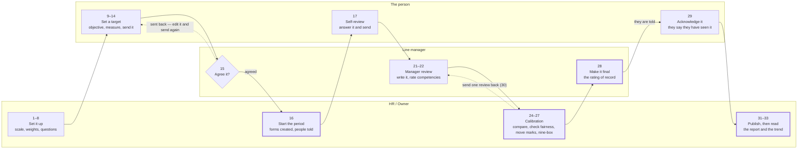
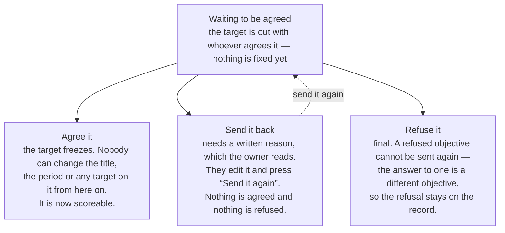
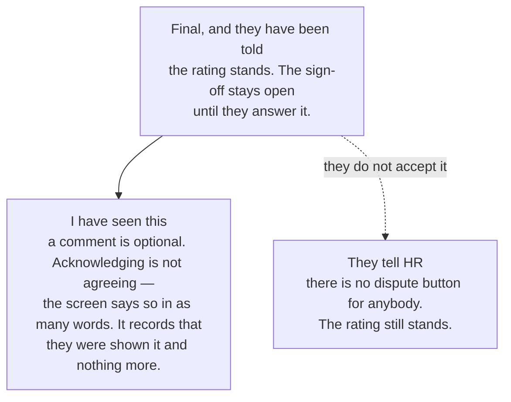

# Running an appraisal, screen by screen

Everything the Performance module does, in the order you actually do it. Follow it top to bottom
with the product open beside you and you will take a company from no appraisal at all to published
marks without guessing once. No code, no database, no jargon that is not explained the first time
it appears.

|                                |                                                               |
| ------------------------------ | ------------------------------------------------------------- |
| **Who this is for**            | Anyone walking the product — no engineering knowledge assumed |
| **How to read it**             | Every step says Where, Who, Click, and what you should see    |
| **How long a full walk takes** | About 40 minutes on seeded data, switching between accounts   |

**Contents** — [Five words](#1-five-words-and-then-everything-else-makes-sense) ·
[The seven doors](#2-the-seven-doors-in-the-sidebar) ·
[The whole thing on one line](#3-the-whole-thing-on-one-line) ·
[The walkthrough](#4-the-walkthrough) ·
[Four seats](#5-the-same-period-from-four-seats) ·
[Eleven surprises](#6-eleven-things-that-will-surprise-you) ·
[What the badges mean](#7-what-the-badges-in-this-document-actually-mean) ·
[A twenty-minute demo](#8-a-twenty-minute-demo-in-order)

---

## 1. Five words, and then everything else makes sense

The module is built out of five ideas. If these are clear, no screen in it will confuse you. If any
one of them is fuzzy, several screens will.

### Appraisal period

A stretch of time you are judging people over — a half, a quarter, a probation. Starting one hands
every employee a form and tells them it is open.

> _A person's mark belongs to one period, never to "the year". Two periods can cover the same person
> and produce two different marks, and that is correct._

### Objective — shown on screen as "KPI"

What somebody is aiming at. A target, filed against a period, owned by one person or given to a whole
department.

> _The screen is called KPIs and the buttons say KPI. Objective is the word the rest of the product
> uses for the same thing. They are not two things._

### Measure

What an objective is judged by. There are two kinds. **A number to reach**: "Offers accepted",
starting at 2, aiming at 8, with progress worked out from it automatically. **Done or not done**:
"Both engineers hired", which has no number at all and counts as not done until a manager confirms
it.

> _An objective with no measure still works — it is then judged on a stated figure by a human rather
> than tracked._

A measure is also **read** or **not read yet**. A number nobody has entered a figure for is not at 0%:
it is unmeasured, and it is left out of the objective's progress until somebody enters one.

### Competency

How somebody works rather than what they delivered — judgement, communication, leading a team. Four
groups come ready-made. Somebody records a level against each one, once per person per period.

> _Leadership is only rated for people who actually manage somebody. For everybody else it is left
> out, not marked low. That distinction matters and the product holds it._

### The mark

What all of it adds up to. Each part carries a percentage of the mark and the percentages total 100%
exactly.

> _There is no state where they do not total 100%, so there is never anything to reconcile
> afterwards. The product refuses a set that does not add up._

> ### The one rule that explains half the screens
>
> An objective must be **agreed before** the period it covers, and only agreed objectives are ever
> scored. A target agreed after the result is known is not a target. This is why there is a whole
> queue screen for agreeing them, why an agreed objective freezes, and why reopening one demands a
> written reason.

---

## 2. The seven doors in the sidebar

Performance is seven separate items in the left-hand nav, not one page with tabs. Some are hidden
from some people — the right-hand column says who sees each one. If a door is missing for the
account you are signed in as, that is the product working, not a bug. Two of the seven are open to
everybody but **narrowed by what they contain** rather than hidden — the queue an ordinary employee
opens is empty, and says so in a sentence.

| Sidebar item            | Route                       | What it is for                                                                                                                  | Who sees it                                                                                                |
| ----------------------- | --------------------------- | ------------------------------------------------------------------------------------------------------------------------------- | ---------------------------------------------------------------------------------------------------------- |
| **Overview**            | `/performance`              | Your landing. What is open, what is waiting on you, what is waiting on somebody else. Start here every time.                    | Everyone                                                                                                   |
| **KPIs**                | `/performance/kpis`         | The objective tree. Create, give out, add measures, record progress, confirm a done-or-not-done measure, send for agreement.                                        | Everyone                                                                                                   |
| **Weekly tasks**        | `/performance/review-tasks` | Staff log what they did each week against an objective; managers grade it. This is the evidence a delivery score is built from. | Everyone                                                                                                   |
| **Competency ratings**  | `/performance/skills`       | Record a level against a skill for one person. Also shows who is below target, and a department heatmap.                        | Everyone                                                                                                   |
| **Appraisal periods**   | `/performance/periods`      | The list of periods. Open one to set it up, start it, move it along, and read the register of everybody in it.                  | HR / Owner                                                                                                 |
| **Objectives to agree** | `/performance/approvals`    | The queue. Somebody sent you a target; you agree it, send it back, or refuse it.                                                | Everyone — but the queue is narrowed to what you may answer, so most people find it empty and are told why |
| **Who appraises whom**  | `/performance/appraisers`   | Only appears if the company has switched multiple appraisers on. Maps who marks whom, and for what share of the mark.           | HR / Owner                                                                                                 |

A further item, **My work record** (`/performance/work-record`), sits beside these for a company that has
Projects switched on, and for nobody else. It is open to everyone and shows only their own (step 33).

More screens exist but have no sidebar item, because you reach them from something specific:

| Route                                | What it is                                                                          |
| ------------------------------------ | ----------------------------------------------------------------------------------- |
| `/performance/periods/{id}`          | One period: set it up, start it, move it along, and read where everybody has got to |
| `/performance/periods/new`           | Draft a period from a few sentences (step 5)                                        |
| `/performance/kpis/import`           | Upload objectives from a spreadsheet                                                |
| `/performance/reviews/{id}`          | One person's appraisal                                                              |
| `/performance/reviews/{id}/answer`   | Answering a review one question at a time, in a window of its own                   |
| `/performance/periods/{id}/report`   | The period's results                                                                |
| `/performance/periods/{id}/nine-box` | The calibration grid                                                                |
| `/performance/periods/{id}/fairness` | How the marks compare across groups of people and across managers (step 25)         |
| `/performance/history/{employeeId}`  | One person across every period                                                      |
| `/performance/how-it-works`          | The product explaining itself, in its own words                                     |

---

## 3. The whole thing on one line

Two views of the same thing. The table below is the five stages a period moves through — always
**forward**, never back. The diagram under it is the same period drawn as a relay between three
people, which is the view to hand somebody who asks "so whose job is this?".

### The five stages

|     | Stage              | HR / Owner is doing                                                                                                    | The manager is doing                                                       | The person is doing                                                         |
| --- | ------------------ | ---------------------------------------------------------------------------------------------------------------------- | -------------------------------------------------------------------------- | --------------------------------------------------------------------------- |
| 1   | **Not started**    | Names the period, sets the dates, writes the questions, decides who it covers                                          | —                                                                          | Sees nothing. No forms exist yet                                            |
| 2   | **Self-review**    | Watches who is outstanding, nudges the late ones                                                                       | —                                                                          | Fills in their own form and sends it                                        |
| 3   | **Manager review** | —                                                                                                                      | Writes their review of each person and sends it. Records competency levels | Nothing. Self-reviews already sent are kept                                 |
| 4   | **Calibration**    | Compares marks across the company, moves any that are out of line with a written reason, places people on the nine-box | Makes each rating final. This is the point at which the person is told     | —                                                                           |
| 5   | **Published**      | Reads the report, the distribution and the trend                                                                       | —                                                                          | Reads what was written about them. Acknowledges it                          |

The four presses that move it between stages, in order: **Start the period** → **Move to manager
review** → **Move to calibration** → **Publish the results**. All four are one-way.

### The same period, as a relay

The numbers in each box are the steps in section 4. Read it as a relay: every arrow that crosses a
lane is a hand-off, and the whole exercise is nine of them. **The two dotted arrows are the only ways
anything ever goes backwards, and both need a written reason.** The four boxes with a thick border —
Start, Calibration, Make it final, Publish — cannot be undone.

> ### Two things about this that catch people out
>
> **Objectives are agreed before any of it.** The agreement loop happens ahead of the period, not
> inside it — that is why it does not appear as a stage. If you start a period with nothing agreed,
> everybody in it will finish with a mark built from competencies alone.
>
> **Moving the stage does not chase anybody.** Moving to manager review does not close self-reviews
> that are still open, and it does not stop a late one arriving. It changes what the product asks
> for next, and nothing more.

---

## 4. The walkthrough

Thirty-four steps in the order they have to happen. Steps marked _optional_ can be skipped on a first
walk and the period will still produce marks. Every other step has something after it that will not
work if you leave it out.

> ### Why the order is what it is
>
> You create the period _first_, while it is still a draft, then file objectives against it, then
> agree them, and only then start it. That looks backwards until you remember the one rule: a target
> has to be agreed before the stretch of time it covers. The draft period is what gives the
> objectives something to be filed against.

### Phase A — once per company: decide what a mark means before you measure anybody

Three settings. You do this once and then leave it alone — a change here never moves a period that
has already started, which is deliberate.

#### 1. Check appraisals are switched on

If this is off, four of the seven sidebar items are hidden and the Overview screen says so plainly.
Nothing is deleted by switching it off, and nothing is lost by switching it back on.

|                |                                                                |
| -------------- | -------------------------------------------------------------- |
| **Where**      | `/settings/features`                                           |
| **Who**        | HR / Owner                                                     |
| **Click**      | Find **Appraisals** in the modules card and make sure it is on |
| **You'll see** | Performance grows from three sidebar items to six or seven     |

#### 2. Name the levels on the scale

Every form shows words, not bare numbers. The built-in five are there from the start; give them your
company's own words if you have them.

|                |                                                                                       |
| -------------- | ------------------------------------------------------------------------------------- |
| **Where**      | `/settings/performance` → **What a mark is called**                                   |
| **Who**        | HR / Owner                                                                            |
| **Click**      | Edit **What level 3 is called** and **What it means** for each of the five, then save |
| **You'll see** | The badge above the form flips from _The built-in five_ to _Your company's words_     |

> ⚠️ **Careful.** Two levels cannot share a word — the product refuses it, because a reader could not
> tell them apart. And a period that has already started keeps the words it started with.

#### 3. Set what the mark is made of

Five parts — objectives, core competencies, behavioural competencies, leadership, and what somebody
said about themselves. You choose the percentage each one carries.

|                |                                                                                                      |
| -------------- | ---------------------------------------------------------------------------------------------------- |
| **Where**      | `/settings/performance` → **The parts of a mark**                                                    |
| **Who**        | HR / Owner                                                                                           |
| **Click**      | Type a whole percentage into each **Weight** box until the running total reads 100%, then save       |
| **You'll see** | Save stays dead until the total is exactly 100%, with a line telling you how much to add or take off |

> 💡 **Worth showing a stakeholder.** The self-assessment card underneath does the arithmetic out
> loud: at 20%, somebody who rates themselves 5 out of 5 rather than 3 out of 5 moves their own final
> mark by 10%. That figure moves as you drag the weight, before you save.

### Phase B — once per period: build it, and leave it as a draft

A draft period is invisible to everybody except the person building it. Nobody has a form and nobody
has been told anything. You can delete it outright right up until you start it, and after that you
never can.

#### 4. Create the period

Name it something people will recognise in their inbox — they see this and nothing else. Everything
except the name is optional and can be filled in later.

| | |
|---|---|
| **Where** | `/performance` or `/performance/periods` |
| **Who** | HR / Owner |
| **Click** | **Start an appraisal period** — top right of either screen |
| **You'll see** | A dialog with **Period name**, the dates, **Answers due by**, and five collapsed sections |

The five collapsed sections, in the order you meet them:

- **What to tell people** — instructions shown above the first question on everybody's form, plus a
  link to your own guide if you have one. This is your only chance to frame the exercise, and most
  companies leave it blank and regret it.
- **Who it covers** — everybody, unless you tick specific departments.
- **Chase people automatically** — one reminder, some number of days before the deadline. It needs a
  due date above to count back from.
- **Let managers add their own questions** — a line manager may add one of their own on top of the
  standard set, asked only of their own department and never the whole company. The same switch sits
  on the period itself; step 7.
- **Appraise the Owner and the HR manager** — two boxes, **both off**, and the closed section reads
  *Nobody* until you tick one. Step 8 is what leaving them off actually does.

> ⚠️ **Careful.** The button reads "Start an appraisal period" but it only _creates_ one. Nothing is
> sent and nobody is told. Starting it is a separate press, at step 16.

#### 5. _Optional_ — let the assistant draft it instead

Describe the period in a paragraph of your own words and it drafts the company goals and the review
questions for you to edit. Everything it writes is editable before it saves.

|                |                                                                                |
| -------------- | ------------------------------------------------------------------------------ |
| **Where**      | `/performance/periods/new`                                                     |
| **Who**        | HR / Owner                                                                     |
| **Click**      | **Draft a period** from the Start dialog, or open the route directly           |
| **You'll see** | Four steps: describe it, edit the goals, edit the questions, review and create |

> ⚠️ **If it says "No assistant is connected"** — that is expected unless somebody has set an AI key
> on the server. The screen says so and gives you two ways out; the ordinary dialog in step 4 does
> the same job by hand. Whether an assistant is wired is shown on `/settings/ai`.

> 💡 **One thing it deliberately will not do.** Every measure it suggests arrives with an **empty
> target box**. A model cannot know whether ₦40m is ambitious or already banked, and the number a
> period is judged against is not something to be guessed. You type every target yourself.

#### 6. Write the questions

A period cannot start with no questions. This is the one thing that actually blocks you.

|                |                                                                                 |
| -------------- | ------------------------------------------------------------------------------- |
| **Where**      | `/performance/periods/{id}` → **Set it up, then start it**                      |
| **Who**        | HR / Owner                                                                      |
| **Click**      | **Write the questions** → **Add a question**                                    |
| **You'll see** | Each question asks three things: the wording, how they answer, and who is asked |

The three settings on a question:

- **How they answer** — in their own words, on the rating scale, or pick from a list you write.
- **Who is asked** — the person themselves, their manager, or their colleagues anonymously. A
  question can go to more than one.
- **Filed under** — which competency subsection it sits under in the list. That only groups the
  question. **An answer to a question never counts towards the mark, however it is filed.** The
  competency part of the mark comes from the level a manager records on the subsection itself (step
  22, **Record a level**), and the dialog says so under the two pickers. A question filed under
  nothing is still asked and answered. Choosing a section and leaving **Subsection** on _None_ files
  it under nothing, and the dialog warns you before you save.

> ✅ **Shortcut.** There is a **Copy from** control that lifts every question off a previous period.
> On a second period this is the whole of this step.

Beside **Write the questions** there is also **Sections and subsections**. That is the company's own
framework of what an appraisal is made of — it starts with Core competency, Behavioural competency,
Key result area and Leadership — and it is shared by every period, past and future, so renaming
something there is not a change to this period alone. You never have to open it to run a period.

#### 7. _Optional_ — let managers add their own questions

A switch on the period. With it on, a line manager can add a question of their own on top of the
standard set, scoped to their own team only.

| | |
|---|---|
| **Where** | `/performance/periods/{id}` |
| **Who** | HR / Owner |
| **Click** | The toggle reading **Let managers add their own questions, scoped to their team** |
| **You'll see** | Nothing changes on this screen. It changes what a manager is offered on theirs |

#### 8. _Optional_ — decide whether the Owner and the HR manager are appraised

Two tick boxes on the same settings card, and **both are off**. So on a new period the person who
owns the company and whoever runs HR are handed no form of their own unless you say otherwise.

| | |
|---|---|
| **Where** | `/performance/periods/{id}`, or the **Appraise the Owner and the HR manager** section of the Start dialog |
| **Who** | HR / Owner |
| **Click** | **Appraise the Owner in this period** · **Appraise the HR manager in this period** |
| **You'll see** | Nothing on this screen. What changes is who the period hands a form to when you start it — one more person for each box you tick |

Two boxes rather than one, because they are two unrelated questions. An HR manager reports to
somebody like anybody else, so a company that does not appraise its owner may still want its HR
manager appraised.

> 💡 **Left out is not let off.** Whoever is unticked still writes their own team's reviews and still
> signs them off. All they lose is a form _about themselves_ — which is also the point, because it is
> what stops them finishing the period counted as unscored.

> ⚠️ **Decide it before you start the period.** Forms are handed out at the moment you start, so
> decide before then. The boxes can still be changed afterwards and the product will not stop you, but
> anybody who already has a form keeps it.

### Phase C — before you start it: set the targets, and get them agreed

This is the half of the module people skip, and skipping it is what produces an appraisal nobody can
defend. An objective that was never agreed is never scored — it will simply be absent from the mark,
silently.

#### 9. Create an objective

Objectives sit in a tree. A company objective at the top, department objectives under it, one
person's objectives under those. You can start anywhere.

|                |                                                                                                            |
| -------------- | ---------------------------------------------------------------------------------------------------------- |
| **Where**      | `/performance/kpis`                                                                                        |
| **Who**        | Line manager · HR / Owner · anyone, for themselves                                                         |
| **Click**      | **New objective**, which opens it, with **Add a KPI under this** waiting in it                             |
| **You'll see** | Four fields: **Objective title**, **Assigned to**, **Due quarter**, **Appraisal period** |

> 🛑 **A personal KPI has to be filed in an appraisal period.** **Appraisal period** is what files the
> KPI against a period, and a KPI filed in none **counts towards nobody's mark**, even once it is
> agreed. So whenever the company has an open period, the field is required on a KPI that is somebody's
> own: it has no _Not part of an appraisal period_ choice, it starts on the period when there is only
> one open, and **Create KPI** refuses with "Choose the appraisal period this is scored in. A KPI with
> none counts towards nobody's mark, even once it is agreed." A published period is never offered.
>
> Two cases stay optional. A **company-wide or department objective** is a standing target and may
> belong to no cycle, so it keeps _Not part of an appraisal period_. And a company with **no open
> period yet** is not stopped from writing its KPIs down: a note reads "No appraisal period is open, so
> this KPI will count towards nobody's mark. Start a period first, then edit the KPI to file it in
> that period."
>
> The server still accepts an objective with no period. This is the form's rule, and it is why
> **Upload objectives** and **Add several objectives** (step 12) warn about an unfiled row and do
> not refuse it.

> ⚠️ **Who you can pick under "Assigned to."** Yourself, plus each department you head.
> The whole company, and every department, only if you hold the records permission. To put a KPI on
> somebody else, open the objective and use **Give a KPI to people**. **Add a KPI under this** has a
> "Assigned to" list of your direct reports, plus everybody in a department you head. If
> somebody you expect is missing from that list, that is why.

#### 10. _Optional_ — change or delete an objective before it is agreed

| | |
|---|---|
| **Who** | Whoever can write the objective: its owner, their line manager, a department head, HR / Owner |
| **Click** | Open the objective, then **Edit** or **Delete** (at the end of the buttons) |
| **You'll see** | **Edit** opens **Objective title** (**KPI title** on a personal one), **Due quarter**, **Appraisal period** and **Description**; **Save changes** stays off until something differs. On a personal KPI the **Appraisal period** is required, as in step 9, so editing an old one that was never filed asks for it; that is the way out of the "no appraisal period" warnings an upload gives. **Delete** asks "Delete this KPI?" ("Delete this objective?" on a company or department one) and says it also removes the measures |

> ⚠️ **Neither is offered once it is agreed.** An agreed target is the record of what two people
> agreed, so **Edit** is replaced by **Reopen the target**, and **Delete** by **Stop this KPI**. The
> card says "Not deletable" and why, in one line. The same goes for a finished or refused one, and
> for one that other objectives ladder up to (move or delete those first). **Who it is assigned to**
> is not in Edit: handing an objective to somebody else is a separate act.

#### 11. Put a measure on it

A measure is what makes progress track itself. Without one, somebody has to state a figure by hand
at the end. It is added in two steps: what kind of measure it is, then what that kind needs.

|                |                                                                       |
| -------------- | --------------------------------------------------------------------- |
| **Where**      | `/performance/kpis` → open the card                                   |
| **Who**        | Line manager · the owner                                              |
| **Click**      | **Add a measure**                                                     |
| **You'll see** | A window called **Add a measure** that first asks **What kind of measure is this?**: **A number to reach** (already chosen) or **Done or not done**, with **Cancel** and **Next**. A number then asks for **Measure**, **Starting value**, **Target value**, **Current value**, **Unit** and a tick box, **This number should go down**. Done or not done asks one thing, **What does done mean?**. **Back** returns to the question and **Add measure** saves it |

> 💡 **For things that should go down** — cost, days-to-hire, complaints. Tick **This number should
> go down** and progress becomes how far it has fallen. Without the tick, a target below the start is
> refused with an explanation rather than silently scored backwards.

> 💡 **Leave Current value blank if nothing has been measured yet.** The measure is then **Not read
> yet**, and it is left out of the objective's progress instead of being counted as 0%. The message
> after you add it says so: _No reading yet, so it is left out of progress until there is one._ A
> figure typed there is a reading, and so is the starting figure typed later as a first reading, because
> 0 can be the honest answer.

**A number: enter a reading.** An unread number says **Not read yet** and **No reading yet · target 40
leads · started at 10 leads**, and offers an empty box with the placeholder **First reading**. Type a
figure and press **Save**; after that it shows **Now …** and a bar like any other. Under the
objective's own bar a line says how much of that figure is a reading:

- some read: **2 of 3 measures read. The others are left out of the figure above until somebody enters a
  reading.**, and the bar is labelled **Progress, from the measures read so far**
- none read: **0 of 3 measures read. Nothing is counted yet, so the figure above is not a result.**
  (**Its measure has not been read. …** when there is only one), the bar is labelled **Progress,
  nothing read yet**, and no percentage is drawn
- all read: no line at all

On the list the card does the same in four words: **No reading yet** where the percentage would be, or
**1 of 3 read** under it. The window closes after a save, as it does for any change on this screen; open
the card again.

**Done or not done: a manager confirms it.** The row shows **Not done yet**. Whoever the objective
belongs to sees **Your manager confirms it when it is done.** and no button, because a yes typed by the
person being judged is the weakest evidence there is. Anybody who may agree the objective (their line
manager, the head of their department, HR / Owner) sees **Confirm it is done**. It asks for **A note, or
a link to the evidence (optional)**, then **Confirm** (or **Cancel**), and the row becomes **Done** with
**Confirmed by Adaeze Okonkwo on 23 Oct 2026.** and the note, in which a link is clickable. **Take it
back** undoes it. A company or department objective has no owner, so confirming one needs the records
permission. It still works once the objective is agreed, because progress is the half that does not
freeze.

> ⚠️ **Until it is confirmed a milestone counts as not done**, at 0% in the average, from the day it is
> made. That is deliberate: a milestone nobody confirmed by the end of the period was not met, and
> leaving it out of the average would let a miss disappear. The message after you add one says so:
> _Done or not done. It counts as not done until it is confirmed._

#### 12. _Optional_ — add several objectives in one go

For a team's quarter. It does what **Upload objectives** does, with the rows typed in instead of
read from Excel: the same checks, with each row judged on your own authority, and everything arrives
as a draft for whoever it is assigned to.

|                |                                                                                                                  |
| -------------- | ---------------------------------------------------------------------------------------------------------------- |
| **Where**      | `/performance/kpis`, beside **Upload objectives**                                                                |
| **Who**        | Line manager · department head · HR / Owner. A plain employee adds their own, one at a time                      |
| **Click**      | **Add multiple**                                                                                                 |
| **You'll see** | A window called **Add several objectives**, with a switch for how the list looks: **Stacked**, **Page by page**, **Table** |

The three layouts hold the same list, so switching never loses anything you typed.

- **Stacked** — every objective is a card, one above the other.
- **Page by page** — one objective at a time, with back and forward arrows and a numbered chip for each.
  A chip turns red when that objective needs a change.
- **Table** — one row each, like Excel. You can paste a block of cells copied from a spreadsheet and it
  fills down and across; **Enter** and the arrow keys move between cells.

Under the switch: **Load from a file** (an .xlsx or .csv; its rows are added after what you have typed,
never over it), **Download draft** (**Excel (.xlsx)** keeps your dropdowns, **CSV** is plain text), and
**Set one value for every objective** for filling one column on everything at once. **Add another**
adds a blank one and **Clear all** empties the window.

Then **Check and review**:

1. If a row is refused, you stay on the form. The top of the window says **1 objective needs a change**
   and lists each one with the reason; each is on its field too. Nothing is created until every row
   passes.
2. If they all pass, the same window turns **read only**: **Review 3 objectives**, with **Read only.
   Nothing is created until you confirm.** The inputs are gone and the cards have a dashed border.
   **Edit again** brings the inputs back with everything you typed, and the next check starts afresh.
3. **Create 3 objectives** makes them. The window says **3 objectives created**. If some did not go in it
   says **1 objective did not go in** with the reason, and **Fix the 1 objective that did not go in** brings
   back only that one, so pressing again cannot create the others twice.

> ⚠️ **Fifty at a time.** The window refuses a fifty-first, or a file that would make one, and says
> where to go instead: **Upload objectives**.

> ⚠️ **Assigned to is a typed work email**, as it is in the spreadsheet, because two people can share
> a name. Somebody with the records permission is offered each person's address while typing. A
> department head is not: the staff list a head can read carries no emails.

> ⚠️ **Leave Appraisal period blank and an objective may count towards nobody's mark.** An
> objective counts towards a person's appraisal mark only once it is filed in an appraisal period. This
> holds for this window and for **Upload objectives** alike, because both go through the same check.
> A row that names a parent objective and leaves the period blank takes the parent's period, as long
> as that period is still open. A row with no parent and no period, or whose parent's period is
> published or has none, is filed in no period. It still imports, since a company may mean it, and
> the check says so before anything is created:
>
> - on the upload page, a yellow callout above the report reads **3 objectives have no appraisal
>   period** (**1 objective has no appraisal period** for one). It explains that they still import, and
>   that the way to file them is to name an open period under **Appraisal period** (the report lets you
>   type it beside each row) or to press **Edit** on the objective before it is agreed (step 10);
> - on each such row, **No appraisal period, so this objective counts towards nobody's appraisal
>   mark.**;
> - in this window the **Appraisal period** dropdown's blank choice reads **None chosen (the parent's
>   period, if any)**.
>
> The parent has to exist already. A parent that is another row of the same file is refused with **It
> has to exist already**, so a period is inherited from existing objectives only. When the check runs
> with no server (demo mode) it can only be sure about the rows with neither a period nor a parent,
> and says so; it never claims a row under a parent will be unfiled.

> 🛑 **Nothing is saved.** Closing with objectives typed asks **Close without creating 3 objectives?**
> with **Keep editing**, **Download Excel draft**, **Download CSV draft** and **Discard**. The download
> is how to carry on later: it opens in Excel, and loads back into this window. The only thing this
> browser remembers is which layout you chose.

#### 13. _Optional_ — give the same objective to several people at once

Word it once; each person gets their own copy to track separately.

|                |                                                          |
| -------------- | -------------------------------------------------------- |
| **Where**      | `/performance/kpis` → open a company or department card  |
| **Who**        | Line manager · HR / Owner                                |
| **Click**      | **Give a KPI to people**, tick the names, confirm        |
| **You'll see** | The button counts what it will do — _Assign to 4 people_ |

#### 14. Send it to be agreed

Until this is pressed the objective is a private draft. It is not in anybody's queue and it cannot
be scored.

|                |                                                                         |
| -------------- | ----------------------------------------------------------------------- |
| **Where**      | `/performance/kpis` → open the card                                     |
| **Who**        | The owner                                                               |
| **Click**      | **Send to be agreed**, then **Send it** on the confirmation             |
| **You'll see** | The card's agreement badge moves from _Draft_ to _Waiting to be agreed_ |

> 💡 **Where to watch it from.** Your own Overview then lists it under **Waiting on somebody else**,
> and it appears in your manager's **Waiting on you** at the same moment. Showing both sides of that
> is the single most convincing thing in a demo.

#### 15. Agree it — as the other person

Sign in as the manager. This is the queue screen, and it has one job.

|                |                                                                                |
| -------------- | ------------------------------------------------------------------------------ |
| **Where**      | `/performance/approvals`                                                       |
| **Who**        | Line manager · HR / Owner                                                      |
| **Click**      | **Agree it** on the row, then confirm                                          |
| **You'll see** | The row leaves the queue and the objective's badge becomes _Agreed_ everywhere |

Each row lists its measures so you can see what you are agreeing to: **Offers accepted, 0 to 10 · now
5**, or **Both engineers hired, done or not done · not done yet**. A number nobody has entered a
figure for reads **· nothing recorded yet**, and one already at its target reads **· already at
target**, which is worth stopping on: a target agreed after the work was done is the one this step
exists to catch. A milestone somebody already confirmed reads **· already confirmed as done** for the
same reason.

There are three answers, and they end differently:

> ⚠️ **Two rules worth saying out loud in a demo**
>
> **Nobody agrees their own.** Your own objective never appears in your own queue, whatever
> permissions you hold.
>
> **Agreed means frozen.** The only way to change an agreed target is **Reopen the target**, which
> demands a reason and records who did it and when. A target that moved with no record of why is what
> makes a rating impossible to defend later.

### Phase D — the period runs: start it, and collect the forms

Starting is the point of no return. It writes a form for every employee who is not archived or
exited, tells them in the app, and the period can never be deleted again.

#### 16. Start the period

|                |                                                                                      |
| -------------- | ------------------------------------------------------------------------------------ |
| **Where**      | `/performance/periods/{id}`                                                          |
| **Who**        | HR / Owner                                                                           |
| **Click**      | **Start the period**, then confirm                                                   |
| **You'll see** | A message counting exactly what happened — _"12 forms created · 12 told in the app. No emails are sent from here."_ |

> 🛑 **Read the two warnings it gives you.** Starting a period returns two lists **by name**, and
> they are the only time anybody is told. Each is a single line on the period screen, and names the
> person when it is only one ("Tunde Bakare has no appraiser"):
>
> **"3 people have no appraiser: …"** — these people will finish the period with no mark at all. Fix
> it on `/performance/appraisers` or by setting their manager on their record.
>
> **"3 people have no agreed objective: …"** — these people have nothing agreed to be judged on, so the
> objectives part of their mark is empty and the rest is reweighted around it.

> ⚠️ **Nothing here sends email.** People are told inside the app only. If your walkthrough audience
> expects an email to arrive, say so before you press it.

#### 17. Fill in a self-review — as an ordinary employee

Sign in as somebody with no special permissions. This is what 90% of the company will ever see of
the module, so it is worth walking properly.

|                |                                                                         |
| -------------- | ----------------------------------------------------------------------- |
| **Where**      | `/performance` → **Waiting on you**                                     |
| **Who**        | The person                                                              |
| **Click**      | **Fill it in** on the row, answer the questions, then **Send it**       |
| **You'll see** | The row leaves _Waiting on you_, and a _Sent_ badge appears on the form |

- **Save and finish later** keeps a half-typed answer without sending it. Nobody else can see a form
  that has not been sent.
- **Overall mark** is optional. Leaving it blank is a real choice — it means the answers say enough —
  and it is not read as a zero anywhere.
- Questions marked as required must be answered before Send will work. The screen counts what is
  still missing.

#### 18. _Optional_ — log what you did each week

A separate, ongoing loop that runs all year rather than at appraisal time. Staff log a line of what
they did against an objective; their manager grades it. It is the evidence behind a delivery score.

|                |                                                                                               |
| -------------- | --------------------------------------------------------------------------------------------- |
| **Where**      | `/performance/review-tasks`                                                                   |
| **Who**        | The person logs · line manager grades                                                         |
| **Click**      | Pick an objective, write what you did, log it. The manager sees it under _Waiting on a grade_ |
| **You'll see** | Rows grouped by the day each task was _logged_ — not the week it covers                       |

A task that a finished issue on a project filed for you carries a small **From project KEY-n** tag, in
**Your weeks**, in an objective's task log and in the grading queue. The tag says where the work came
from; the grade is still the manager's. It is a link only if you can open that project, and plain
text if you cannot.

#### 19. Chase the people who have not sent theirs

|                |                                                                                                         |
| -------------- | ------------------------------------------------------------------------------------------------------- |
| **Where**      | `/performance/periods/{id}` → **Still to come in**                                                      |
| **Who**        | HR / Owner                                                                                              |
| **Click**      | **Nudge who is late**                                                                                   |
| **You'll see** | A count of who was nudged — and, separately, how many could not be reached because they have no sign-in |

> ✅ **The honest number.** Somebody with no login cannot be nudged in the app, and the product says
> so as its own line rather than quietly counting them as reached. It is a small thing that a careful
> PM will notice and like.

#### 20. Move it to manager review

|                |                                                                         |
| -------------- | ----------------------------------------------------------------------- |
| **Where**      | `/performance/periods/{id}`                                             |
| **Who**        | HR / Owner                                                              |
| **Click**      | **Move to manager review**                                              |
| **You'll see** | _"Managers write their reviews now. Self-reviews already in are kept."_ |

> 🛑 **One-way.** There is no button that moves a stage backwards, in this screen or anywhere else.

#### 21. Write a review of somebody — as their manager

|                |                                                                                                   |
| -------------- | ------------------------------------------------------------------------------------------------- |
| **Where**      | `/performance` → **Waiting on you**                                                               |
| **Who**        | Line manager                                                                                      |
| **Click**      | **Fill it in**, answer, set an **Overall mark**, then **Send it**                                 |
| **You'll see** | Their self-review is readable beside your own form, under _What they said about their own period_ |

> 💡 **The language check — worth demonstrating.** Press Send and the product reads what you wrote
> first. It flags language describing a _person_ rather than their _work_, absolutes, comparisons to
> a colleague, and anything touching a protected characteristic — quoting your exact phrase back at
> you. It never blocks: the button becomes **Send anyway** on the second press.
>
> Type _"Chidera is quite disorganised"_ into a manager review and watch it catch. Then type _"the
> Lagos migration was difficult"_ and watch it correctly say nothing. This runs entirely inside the
> product — no written appraisal comment is sent anywhere.

#### 22. Record competency levels

Separate from the review form, and easy to forget. A person with no competency ratings gets a mark
built from their objectives alone.

|                |                                                                                 |
| -------------- | ------------------------------------------------------------------------------- |
| **Where**      | `/performance/skills`                                                           |
| **Who**        | Line manager · HR / Owner                                                       |
| **Click**      | **Record a level** → who, which skill, where they are now, where they should be |
| **You'll see** | The _Below target_ count and the department heatmap both move as you record     |

> 🛑 **The same trap as step 9.** **Appraisal period** is on this dialog too. Leave it blank and the level is
> recorded but counts towards no period's mark.

#### 23. _Optional_ — ask colleagues for feedback

|                |                                                                                          |
| -------------- | ---------------------------------------------------------------------------------------- |
| **Where**      | `/performance/periods/{id}` → the _Feedback_ column on a person's row                    |
| **Who**        | HR / Owner                                                                               |
| **Click**      | Search names, tick who to ask, send. Each of them gets a form waiting in the app         |
| **You'll see** | Answers appear on the person's own Overview under _Peer feedback_, with no name attached |

### Phase E — calibration: compare across the company, then make the marks final

Calibration is the stage where a company looks at every mark side by side and asks whether two
managers have been using the same scale. It is also where a rating stops being a draft and becomes
the thing a person is told.

#### 24. Move it to calibration

|                |                                                                                                               |
| -------------- | ------------------------------------------------------------------------------------------------------------- |
| **Where**      | `/performance/periods/{id}`                                                                                   |
| **Who**        | HR / Owner                                                                                                    |
| **Click**      | **Move to calibration**                                                                                       |
| **You'll see** | _"Marks are in. Nothing more is asked of anyone until you publish."_ A _Calibration_ column appears on the register |

> 💡 **This is what unlocks finalising.** Ratings to be made final only appear in a manager's
> **Waiting on you** once the period is at calibration. If a manager tells you they cannot see
> anything to finalise, this is almost always the reason.

#### 25. _Optional_ — check the marks for fairness

Before you move anything, look at how the marks fall. This screen compares the marks as the answers
produced them, before any calibration move, across groups of people and across managers, and flags the
gaps worth a second look. It does not change a mark.

|                |                                                                                                                                                  |
| -------------- | ------------------------------------------------------------------------------------------------------------------------------------------------ |
| **Where**      | `/performance/periods/{id}/fairness`                                                                                                             |
| **Who**        | Whoever holds the **See the fairness check** permission                                                                                          |
| **Click**      | **Fairness check**, at the top of the period screen once the period has started                                                                  |
| **You'll see** | **Marks compared**, **Gaps flagged**, **Groups hidden** and **Company average**, then three tabs: **Groups**, **Managers** and **Calibration moves** |

- **Groups** is one card per way of grouping people — the permission names gender, age, time at the
  company, location, contract type and department. Each card reads **Flagged**, **No clear gap** or
  **Too few to compare**, and can be shown as an **Average**, as **Bands** or as a **Table**.
- **Managers** shows the average mark each manager gave, and flags a manager whose marks sit well apart
  from everyone else's, or barely vary at all.
- **Calibration moves** counts the marks that were moved up and down, by group, and lists the latest
  moves with the reason given for each.
- **This period** and **Last 3 periods** at the top switch what is counted.
- **How flags work**, at the foot, states the rules in the product's own words: a group is flagged only
  when its gap is large enough and its likely range does not cross zero, and groups under a minimum
  size are hidden.

> 💡 **Group averages only, never one person's.** A group too small to show is hidden rather than
> shown, so that no figure on this screen can be traced back to somebody. Religion and state of origin
> are not checked at all, and the screen says so.

> ⚠️ **Not on the shared QA site yet** (20 October 2026). The button only appears for somebody who
> holds the permission, and the server's side of it — the permission and the check itself — is on a
> backend branch that has not reached `staging`, so there nobody holds it. Delete this note when it
> ships.

#### 26. Move a mark that is out of line

One manager marks generously and another marks hard. Calibration is where that is corrected, on the
record rather than in a corridor.

|                |                                                                                 |
| -------------- | ------------------------------------------------------------------------------- |
| **Where**      | `/performance/periods/{id}` → **Where the marks stand**                         |
| **Who**        | HR / Owner                                                                      |
| **Click**      | **Change the mark** on the row → new percentage → **Why**                         |
| **You'll see** | The row shows both figures: what the answers produced, and what it was moved to |

> ⚠️ **The reason is not optional and not a formality.** It is kept with the mark and it is what
> explains the change if anybody asks years later. A few words is refused; the product asks for a
> sentence.

#### 27. _Optional_ — place people on the nine-box

Performance against potential, on a three-by-three grid. Performance comes from the period; potential
is a judgement somebody records here.

|                |                                                                                            |
| -------------- | ------------------------------------------------------------------------------------------ |
| **Where**      | `/performance/periods/{id}/nine-box`                                                       |
| **Who**        | HR / Owner                                                                                 |
| **Click**      | **Place them** on somebody in the _Not on the grid_ list → how far could they go → **Why** |
| **You'll see** | They move onto the grid, and the _Not placed_ count falls                                  |

> ✅ **Worth pointing out to a stakeholder.** Anybody missing either half is **named underneath the
> grid** with which half is missing, rather than being dropped into the bottom-left box. As the screen
> puts it: having no mark is not the same as a low one. Most nine-box tools get this wrong.

#### 28. Make a rating final

The most consequential button in the module. It turns a written review into the rating of record and
tells the person.

|                |                                                                                           |
| -------------- | ----------------------------------------------------------------------------------------- |
| **Where**      | `/performance/reviews/{id}` — reached from **Waiting on you**                             |
| **Who**        | Line manager · HR / Owner                                                                 |
| **Click**      | **Make it final**, then confirm                                                           |
| **You'll see** | A _Final_ badge, and the row moves to **Waiting on somebody else** — it is their move now |

> 🛑 **It cannot be changed afterwards.** The confirmation says so. Once final, the mark cannot be
> changed, and the person has been told. If a review genuinely needs redoing after this, the only
> route is step 30.

### Phase F — the person answers: sign-off

A final rating is not finished until the person it is about has answered it. Leaving it unanswered is
deliberately not one of the options.

#### 29. Acknowledge it

|                |                                                                                                                                                                       |
| -------------- | --------------------------------------------------------------------------------------------------------------------------------------------------------------------- |
| **Where**      | `/performance/reviews/{id}` — reached from **Waiting on you**, or from the **Your rating is final** card on Overview                                                  |
| **Who**        | The person                                                                                                                                                            |
| **Click**      | **I have seen this**, then **I have seen this** again in the **Acknowledge this rating** window. A comment is optional                                                 |
| **You'll see** | A banner reading _"Your rating is final and needs your response"_ above the button. After the click the window turns into a statement of what was recorded, and the review gains an **Acknowledged** card with the date |

> ⚠️ **There is no "I do not accept it" button.** There was, and it was removed on 11 September 2026:
> the person a rating is about should not be the one who decides whether a disagreement becomes a
> formal record. Overview says what to do instead — _"If you do not accept it, tell HR, because only
> they can record a formal dispute."_ The server will take a dispute from somebody holding the records
> permission, but nothing in the product sends one, so today that can only happen over the API. A
> review disputed before the button went still shows **Disputed**, with the person's words beside the
> mark. Why it is like this: [ADR-0008](../adr/0008-an-employee-acknowledges-a-rating-and-only-hr-records-a-dispute.md).

> ⚠️ **One answer only.** The acknowledgement is stored with its date and cannot be given twice. Three
> separate states exist and the product never confuses them — _acknowledged_, _disputed_ (only on a
> review disputed before 11 September) and _nobody has asked them yet_, which is the common one.

#### 30. _Optional_ — send one review back to be redone

The escape hatch. It reopens exactly one review so one person can have another pass at it. Nobody
else's review moves.

|                |                                                                                         |
| -------------- | --------------------------------------------------------------------------------------- |
| **Where**      | `/performance/periods/{id}` → the _Revision_ column                                     |
| **Who**        | HR / Owner                                                                              |
| **Click**      | **Send back** → choose **Manager review** or **Self-appraisal** → **Why**               |
| **You'll see** | The row reads _Sent back, waiting for them to send it again_, and the reason is shown to the person |

> 💡 **It asks which review rather than guessing.** Self-appraisal and manager review are two
> different documents by two different people. Reopening the wrong one would send the wrong person
> back to work.

### Phase G — close it out: publish, then read what the period actually said

#### 31. Publish the results

|                |                                                                                                                                              |
| -------------- | -------------------------------------------------------------------------------------------------------------------------------------------- |
| **Where**      | `/performance/periods/{id}`                                                                                                                  |
| **Who**        | HR / Owner                                                                                                                                   |
| **Click**      | **Publish the results**, then confirm                                                                                                        |
| **You'll see** | Either _"People can now read what their manager wrote about them."_, or a count of how many people finish with no mark — **by name**: _"2 people finish with no mark: …"_ |

> ⚠️ **Read the names it gives you.** If anybody finishes with no mark, publishing is the last moment
> anybody is told. Those people go through a whole appraisal period and come out the other side with
> nothing.

#### 32. Read the period report

|                |                                                                                                                 |
| -------------- | --------------------------------------------------------------------------------------------------------------- |
| **Where**      | `/performance/periods/{id}/report`                                                                              |
| **Who**        | HR / Owner                                                                                                      |
| **Click**      | **See the report** from the period screen                                                                       |
| **You'll see** | Headcount, how many have a mark, the average, the distribution across the five bands, and a table by department |

> ✅ **The thing to check, and the thing to say.** **Two headcounts, never divided into each other.**
> "People in this period" and "with a mark" are separate figures in separate cards, each stating its
> own total. The average is over the marks that exist and reads as blank when there are none — never
> 0%.
>
> Three lists name people rather than counting them: _nobody marked them_, _written but not
> finalised_, and _told, and no answer yet_. Those are the three things that stop a period from being
> finished.

#### 33. Read one person across every period

|                |                                                                                            |
| -------------- | ------------------------------------------------------------------------------------------ |
| **Where**      | `/performance/history/{employeeId}`                                                        |
| **Who**        | HR / Owner · their manager · themselves                                                    |
| **Click**      | Reached from a person's record and from the appraisal screen                               |
| **You'll see** | Two tabs. **Appraisal history** is every mark in order, with the change against the previous one, and what was said each time. **Work record** is what they finished on the project boards (below) |

> 💡 **Two details worth demonstrating.** A period where nothing was recorded is **skipped, not
> plotted as zero** — the change is measured against the last period that actually has a mark, and the
> empty ones are named underneath. A fall and a recovery that never happened is the easiest chart in
> the world to draw by accident.
>
> The person themselves sees only finalised marks, and is told how many are withheld. A working
> figure moves every time somebody records a rating, so they see it when it is final and not before.

**The Work record tab, and My work record.** The same panel is on the **Work record** tab of this page
and, for yourself, as **My work record** in the sidebar (`/performance/work-record`). It shows what a
person finished on the project boards, for a **Period** of **Day**, **Week**, **Month** or **Quarter**,
stepped with **Previous period** and **Next period**, and opens on the current week. Four tiles:

| Tile                          | What it says                                                                                                                                  |
| ----------------------------- | --------------------------------------------------------------------------------------------------------------------------------------------- |
| **Tasks finished**            | How many tasks were finished in the period                                                                                                    |
| **Done by due date**          | "7 of 9": how many of the tasks that had a due date were finished by it. It shows a dash, with "None of these had a due date", when none did |
| **Completion rate**           | The percentage, as the appraisal works it out from graded weekly tasks. A dash when the server has no rate to give                                       |
| **Count toward an objective** | "6 of 9": how many are linked to an objective                                                                                                 |

Under them, **By objective** lists each objective (and the KPI inside it) with how many were finished and
the completion rate, with a line for "Not linked to an objective". Then one card per day, in the
order the server sends them, each task with its key (which opens it on its project; a task from somebody's own
list, with a key like `MY-3`, has no project and opens on a page of its own), its title, its project (**Personal**
for a task from somebody's own list), its labels, its grade
(**Completed**, **Partly completed**, **Not completed**, **Rejected**, or **Waiting for a grade** where a weekly
task of theirs is attached and not yet graded) and any links to other tasks, such as "Blocks PRJ-12", or
"Blocks a task you can't open". A period with nothing in it reads "Nothing finished on the board in this
week." The figures are the server's own; the screen works nothing out. Where somebody may not open
another person's record it says "You can't open this person's work record." It needs the server, so
there is nothing to see in the demo.

#### 34. Start the next one

Back to step 4. On a second period, step 6 collapses to one press of **Copy from**, and phases A and
B are already done.

|                |                                                                                               |
| -------------- | --------------------------------------------------------------------------------------------- |
| **Where**      | `/performance/periods`                                                                        |
| **Who**        | HR / Owner                                                                                    |
| **Click**      | **Start an appraisal period**                                                                 |
| **You'll see** | The previous period stays exactly as it was. Marks belong to a period, not to a person's year |

---

## 5. The same period, from four seats

Nobody does all thirty-four steps. Here is the whole of each person's job, so you can hand somebody one
card and nothing else.

### The person — every employee

Sees five sidebar items — Overview, KPIs, Weekly tasks, Competency ratings and Objectives to
agree. Never sees a period, a register or a report.

1. Set your own objectives on **KPIs** and press **Send to be agreed**.
2. Log what you did each week on **Weekly tasks**, if your company uses it.
3. When a period starts, fill in your self-review from **Overview** and send it.
4. When your rating is final, answer it: **I have seen this**. If you do not accept it, tell HR — there
   is no button for that.

> **Everything you owe is on Overview.** If that screen says _Nothing needs you_, you are up to date.
> There is nowhere else to check.

### Line manager — anyone with reports

Everything above, plus four things about other people. Not a role you are given — it follows from
who reports to you.

1. Agree your reports' objectives on **Objectives to agree**, or send them back with a reason.
2. Set objectives _for_ your reports on **KPIs**.
3. Write a review of each report when the period reaches manager review, and record their competency
   levels.
4. At calibration, press **Make it final** on each one.

> ⚠️ **Being a department head widens this** to everybody in your department, not only your direct
> reports. Being given the **Departmental Lead** role by hand does not — that role's own permissions
> are about leave, basic record details, starting an exit and equipment, and carry nothing here. (It
> used to be called Department Manager.)

### HR / Owner — runs the exercise

Sees all seven items — the seventh, **Who appraises whom**, only if the company has switched multiple
appraisers on. Holds the settings and the company-wide reads.

1. Once: the scale, the weights, and the feature switch.
2. Per period: create it, write the questions, decide who it covers, start it.
3. While it runs: watch who is outstanding, nudge, move the stage along.
4. At calibration: check the fairness view if you hold that permission, move any mark that is out of
   line, place people on the nine-box.
5. At the end: publish, then read the report.

> 🛑 **Four presses are one-way** and every one of them is yours: start, each stage move, and publish.
> Nothing takes a period backwards.

### A colleague — asked for feedback

Not a role at all — anybody can be asked, once, about one person.

1. A form appears under **Waiting on you** on your Overview.
2. Answer it and send it. That is the whole of it.
3. Your answers reach the person with **no name attached**.

> The screen states the anonymity once, at the top, and claims exactly what is true: no name is
> attached to an answer, for anybody, including HR.

---

## 6. Eleven things that will surprise you

Every one of these is deliberate. If you are demonstrating the product, several are worth pointing at
on purpose — they are the arguments the module is built on.

| What you will notice | Why it is like that |
|---|---|
| **Nothing sends email.** | People are told inside the app only — starting a period, being nudged, being told a rating is final. Every message that mentions it says so rather than leaving you to find out. |
| **An empty figure is blank, never 0%.** | Nobody scored yet reads *No mark*. A competency nobody rated reads *Nothing recorded*. A zero would be a claim that somebody performed at nothing, which is a completely different fact from nobody having looked. |
| **Leadership is missing for most people.** | It is only rated for people who actually manage somebody. For everybody else it is left out of the mark and the rest is reweighted, rather than being scored low. |
| **You cannot agree your own objective.** | Whatever permissions you hold, your own never appears in your own queue. Same rule as payroll: the person who proposes something is not the person who signs it off. |
| **An agreed objective cannot be edited.** | Not the title, not the period, not any target, and no new measure — because adding one changes what delivering it means. **Reopen the target** is the only way through and it records who, when and why. |
| **A refusal is final.** | A refused objective cannot be resubmitted. The answer to a refused objective is a *different* objective, so the refusal stays on the record instead of being written over. |
| **Changing the weights does not move a running period.** | A period keeps the weights and the scale words it started with. Otherwise a mark somebody was told in March would quietly become a different mark in June. |
| **"Make it final" only appears at calibration.** | A manager at the manager-review stage has nothing to make final and correctly sees no such button. Move the period to calibration and the rows appear. |
| **A measure nobody has read is not a measure at 0%.** | A number added with no current value reads *Not read yet* and is left out of the objective's progress until somebody enters a figure, and an objective with nothing read shows *No reading yet* instead of a percentage. A zero would claim the work had not moved, which is a different fact from nobody having looked. Typing the starting figure as a first reading is a reading. |
| **Only a manager says a milestone is done.** | A *Done or not done* measure has no number to type, and the person whose work it is never sees a Confirm button. Until it is confirmed it counts as *not done*, because a milestone nobody confirmed by the end of the period was not met. |
| **The Owner and the HR manager get no form.** | Both off on every new period, and each is its own tick box. The Owner reports to nobody, so the reporting line has no one to put on their form; the HR manager would otherwise be marking themselves against questions they wrote. Neither is let off anything — both still appraise their own teams. Tick either box on the period to include them (step 8). |

---

## 7. What the badges in this document actually mean

Four labels have been used throughout. Here is exactly what each one is, in case you need to set an
account up or ask an engineer why somebody cannot see something.

| Badge            | What it really is                                                                                                                                                           | Who has it out of the box                                                                                      |
| ---------------- | --------------------------------------------------------------------------------------------------------------------------------------------------------------------------- | -------------------------------------------------------------------------------------------------------------- |
| **Everyone**     | Any account that can sign in. No permission required.                                                                                                                       | Everybody, including the Employee role, which holds nothing.                                                   |
| **The person**   | The subject of the form. Resolved from who they are, not from a permission.                                                                                                 | Whoever the review or objective is about.                                                                      |
| **Line manager** | **Having direct reports.** Not a role — it follows from the reporting line on people's records. Widened to a whole department for whoever is set as that department's head. | Nobody, until somebody's record names them as a manager.                                                       |
| **HR / Owner**   | Two separate permissions that happen to travel together: _Manage settings_ (start a period, weights, scale) and _Edit records_ (read every mark in the company).            | The **Owner** and **HR manager** roles. Notably **not** Departmental Lead, Branch Manager or Payroll officer. |

> ⚠️ **The one that trips people up in testing.** The role called **Departmental Lead** (formerly
> Department Manager) carries no performance permission. Whoever heads a department holds it
> automatically, and what it covers is approving that department's leave first, editing basic details,
> starting an exit and seeing its equipment. What gives somebody authority over appraisals is the fact
> that earns the role — being _set as the head of a department_ on the Departments screen — or having
> people report to them. Handing the role to somebody by hand gives them the leave and equipment rights
> and nothing in Performance.

---

## 8. A twenty-minute demo, in order

If you have one sitting and an audience, this is the sequence. It skips everything optional and shows
both sides of every hand-off, which is the part that convinces people. You will need three accounts
open — an ordinary employee, their manager, and an HR or Owner account. The sign-in screen lists the
seeded accounts to use.

| #   | Do this                                                                                                                     | What to point at                                                                                                                   |
| --- | --------------------------------------------------------------------------------------------------------------------------- | ---------------------------------------------------------------------------------------------------------------------------------- |
| 1   | **HR** — `/settings/performance`. Show the five weights totalling 100%, then drag one so it does not.                       | Save goes dead and the product tells you how much to add. A mark that cannot fail to add up.                                       |
| 2   | **HR** — **Start an appraisal period**. Name it, set a due date, open _What to tell people_, type two sentences. Create it. | Nobody has been told anything yet. Say so.                                                                                         |
| 3   | **HR** — **Write the questions**. Add one for the person and one for their manager.                                         | _Filed under_. And Start is dead until at least one question exists, and says why.                                                 |
| 4   | **Employee** — `/performance/kpis`. **New objective**, set _Appraisal period_ to the new period, add a measure, **Send to be agreed**.   | Their Overview now shows it under _Waiting on somebody else_.                                                                      |
| 5   | **Manager** — `/performance`. The same objective is in **Waiting on you**. Open the queue and agree it.                     | Both sides of one action, thirty seconds apart. **This is the moment the demo lands.**                                             |
| 6   | **Manager** — go back to KPIs and try to change the target you just agreed.                                                 | The controls are gone and a sentence above says why. Not a refusal after the click — the offer was never made.                     |
| 7   | **HR** — **Start the period**. Confirm, then read the result out loud.                                                      | How many forms, how many told, and any names it gives you. "Nobody is appraising them" if it appears.                              |
| 8   | **Employee** — **Fill it in**. Answer, leave the overall mark blank on purpose, send it.                                    | Blank is a choice, and nothing downstream reads it as zero.                                                                        |
| 9   | **HR** — **Move to manager review**.                                                                                        | Self-reviews already in are kept. Say it; people assume otherwise.                                                                 |
| 10  | **Manager** — write the review. Type _"Chidera is quite disorganised"_ and press Send.                                      | It quotes the phrase back at you and the button becomes **Send anyway**. It never blocks — and nothing you typed left the product. |
| 11  | **HR** — **Move to calibration**, then **Change the mark** on one person with a reason.                                       | The row keeps both figures: what the answers produced, and what it was moved to.                                                   |
| 12  | **Manager** — **Make it final**. Read the confirmation aloud before pressing it.                                     | This is the one-way door and the moment the person is told.                                                                        |
| 13  | **Employee** — answer it. **I have seen this**.                                                                             | The sentence saying acknowledging is not agreeing, and the **Acknowledged** card that replaces the banner. One answer, once.       |
| 14  | **HR** — **See the report**. Finish here.                                                                                   | The two headcounts, and the three lists of names: nobody marked them, written but not finalised, told and no answer yet.           |

---

*Written against the product as it stands on 20 October 2026. Every button label, field name and
message quoted here is the wording actually on screen — where the product says something in its own
words, this document quotes it rather than paraphrasing, so the two cannot drift apart. If a label
here does not match what you are looking at, trust the screen and flag the difference._
